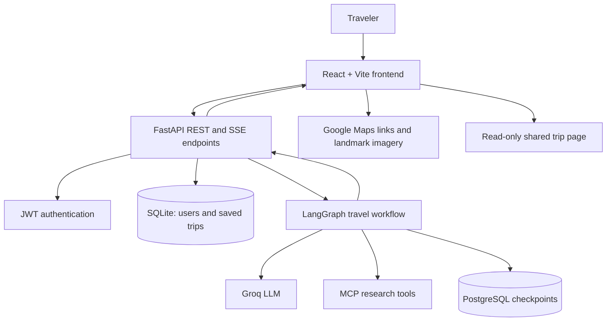

# Journey Gen AI

**AI-powered, multi-agent travel planning application**

Journey Gen AI helps travelers prepare personalized, day-by-day trip itineraries. It combines user preferences with selected AI research agents for transport, accommodation, weather, and budgeting. Travelers can review and regenerate individual days, save their plans, and share read-only itineraries.

> **Project status:** Functional local application. External travel research and budget allowances are planning aids, not confirmed bookings or live prices.

## 1. Project overview

**Problem:** Planning a trip often requires switching between several websites to compare transport, hotels, weather, sightseeing locations, and budgets. Generic itineraries may not respect a traveler's dates, starting city, interests, group size, or preferences.

**Solution:** Journey Gen AI offers a single interface to enter travel requirements, run appropriate research agents, generate a concise itinerary, review the result, and save or share it.

**Primary goal:** Make travel planning more personalized, organized, and easy to revise—without presenting unverified search results as booked services.

## 2. Key features

| Feature | What it does |
| --- | --- |
| AI trip planner | Generates a day-wise itinerary from source, destination, dates, travelers, interests, and other preferences. |
| Conditional multi-agent research | Runs applicable research agents based on the options selected; itinerary generation remains the core workflow. |
| Transport research | Provides references for selected flight, train, bus, or road options, subject to provider verification. |
| Hotel research | Surfaces accommodation research relevant to the chosen stay category. |
| Weather information | Presents weather context with a distinction between current conditions and forecasts for travel dates. |
| Budget planning | Shows illustrative allowances and provides an editable budget calculator; does not claim live booking quotes. |
| Day-by-day itinerary | Organizes activities, suggested times, sightseeing points, and important notes. |
| Maps and photos | Provides links to Google Maps and destination/landmark imagery when available. |
| Regenerate one day | Previews an alternative for a chosen day; accepting it preserves other days. |
| Saved trips dashboard | Lists saved itineraries with locations, trip dates, traveler details, and budget preferences. |
| Trip details | Displays saved itinerary content and supports updates to accepted regenerated days. |
| Public sharing | Creates a read-only shared link and QR code; sharing can be disabled. |
| User authentication | Registration, login, profile, and access-controlled saved trips. |
| Appearance and responsiveness | Light/dark/system themes and layouts designed for desktop and smaller screens. |
| Help & Support | An in-app guidance page for common questions and troubleshooting. |

## 3. Technology stack

| Layer | Technology |
| --- | --- |
| Frontend | React, Vite, JavaScript/JSX, CSS |
| UI icons | `lucide-react` |
| Frontend HTTP client | Axios |
| Backend API | Python, FastAPI, Pydantic |
| AI orchestration | LangGraph |
| Language model integration | Groq via `langchain-groq` (configured model: `openai/gpt-oss-120b`) |
| Tool integrations | MCP (Model Context Protocol) clients and services, including travel search and weather-related tools |
| Saved users and trips | SQLite (`backend_trips.db`) |
| Workflow checkpointing | PostgreSQL with LangGraph `PostgresSaver`, as configured in the backend |
| Authentication | JWT-based protected API routes |
| Itinerary rendering | Markdown and structured activity components |

## 4. High-level architecture



**End-to-end planning flow:**

1. Traveler enters the starting location, destination, trip dates, travelers, and optional preferences.
2. The Planner determines which research agents are needed based on the selected options.
3. FastAPI invokes the LangGraph workflow and streams supported agent progress to the frontend.
4. Research agents obtain relevant reference information through configured tools; the itinerary agent builds the travel plan.
5. Traveler reviews the generated itinerary and can regenerate an individual day.
6. When the traveler accepts the result, the application saves the itinerary and its associated preferences.
7. The Dashboard, Saved Trip Details, and public shared link reuse the saved trip data.

## 5. Main application pages

- **Home:** Welcome screen, destination inspiration, recent saved trips, basic travel statistics, and an explanatory agent-workflow diagram.

- **AI Planner (`/planner`):** Travel form, selected-agent research, itinerary generation, maps, notes, and budget calculator.

- **My Trips (`/dashboard`):** Searchable and filterable saved-trip collection.

- **Saved Trip Details (`/trips/:id`):** Full itinerary, day-level regeneration, PDF/export options, and sharing controls.

- **Public Trip (`/shared/:shareToken`):** Read-only public version of an explicitly shared itinerary.

- **Login / Signup / Profile:** Account creation, authentication, and profile management.

- **Help & Support (`/help-and-support`):** In-app FAQs and guidance.

## 6. Project structure

The following is a simplified structure based on the files used in this project. Additional assets, server scripts, and environment folders may be present.

```text
Journey_Gen_AI_MultiAgent_System_with_MCP/
├── backend_api.py           # FastAPI app (exports 'api')
├── main.py                  # LangGraph orchestration and itinerary logic
├── mcp_client.py            # MCP client/tool integrations
├── backend_trips.db         # Local SQLite DB, created/used by backend
├── .env                     # Local backend secrets (do not commit)
├── frontend/
│   ├── package.json
│   ├── src/
│   │   ├── App.jsx          # Client-side routes and app theme
│   │   ├── pages/
│   │   │   ├── Home.jsx
│   │   │   ├── Planner.jsx
│   │   │   ├── Dashboard.jsx
│   │   │   ├── TripDetails.jsx
│   │   │   ├── PublicTrip.jsx
│   │   │   ├── Login.jsx
│   │   │   ├── Signup.jsx
│   │   │   └── Profile.jsx
│   │   ├── components/     # Navigation, footer, cards, etc.
│   │   └── services/
│   │       ├── aiService.js # API operations
│   │       └── api.js       # Axios instance and auth handling
│   └── public/             # Static images/icons
└── aviationstack-mcp/      # Tool integration, if configured
```

## 7. How to run locally

### Prerequisites

- Python environment with the project's backend dependencies installed.

- Node.js and npm for the React/Vite frontend.

- Available API credentials for enabled Groq and optional research tools.

- Configured PostgreSQL server/connection for LangGraph checkpointing, if used by the current `main.py`.

### A. Configure backend environment

In the project root, create/update `.env` with your own values. **Do not copy real keys into documentation, screenshots, or Git.**

```dotenv
JWT_SECRET_KEY=replace_with_your_own_long_random_secret
GROQ_API_KEY=your_groq_api_key
DATABASE_URL=your_postgresql_connection_url
# Additional MCP provider keys depend on your mcp_client.py configuration.
```

`DATABASE_URL` is used by the project's LangGraph configuration; the saved-trip/user database is separately stored in SQLite. Ensure the exact optional MCP variables match your installed client and server scripts.

### B. Start the backend

Open a terminal in the project root, activate your existing Python virtual environment, and start FastAPI:

```powershell
python -m uvicorn backend_api:api --reload --host 127.0.0.1 --port 8000
```

The FastAPI instance is named **`api`**, not `app`, in `backend_api.py`. Confirm the `/health` endpoint responds at `http://127.0.0.1:8000/health`.

### C. Start the frontend

Open a second terminal:

```powershell
cd frontend
npm install
npm run dev
```

Open `http://localhost:5173`. The frontend Axios client is configured for a local FastAPI backend; if you use a custom URL, set `VITE_API_BASE_URL` as supported by your current `api.js` and restart Vite.

> The project has already been developed locally. This section documents the startup procedure; it is **not** a guarantee that a fresh computer has every MCP server and dependency preconfigured. Preserve your working virtual environment and dependency lockfiles.

## 8. Selected backend API routes

| Method | Path | Purpose |
| --- | --- | --- |
| POST | `/auth/register` | Create a user account |
| POST | `/auth/login` | Authenticate a user |
| GET / PATCH | `/auth/me` | Read/update the logged-in profile |
| POST | `/generate-trip` | Generate a trip |
| POST | `/generate-trip/stream` | Generate with progress events |
| POST | `/generate-trip/regenerate-day` | Generate an alternative for one day |
| POST | `/trips` | Save an itinerary |
| GET | `/trips` | List the user's saved trips |
| GET / PUT / DELETE | `/trips/{trip_id}` | Read, update, or delete a saved trip |
| POST / DELETE | `/trips/{trip_id}/share` | Enable or revoke public sharing |
| GET | `/public/trips/{token}` | Read a publicly shared itinerary |
| GET | `/trips/{trip_id}/day-photos/{day_number}` | Request saved-trip day photos |
| GET | `/health` | Service health check |

## 9. Demo walkthrough

For a project demonstration, show this sequence:

1. **Log in** with a test account.
2. **Open the Planner** and select an origin, destination, dates, and travelers.
3. **Choose only the desired options** (such as train, hotel, and weather) to demonstrate conditional research agents.
4. **Generate the itinerary** and explain the agent progress display, result disclaimers, day-wise activities, and maps.
5. **Regenerate one day**, compare the preview, and accept or keep the original.
6. **Save the trip**, then open it from the Dashboard to show the same dates, travelers, and full itinerary.
7. **Create a share link** and open the read-only version. Show that public access can be revoked.
8. **Switch light/dark mode** and briefly show mobile responsiveness.

## 10. Important limitations and responsible use

- Flight, train, bus, and hotel search references **do not prove availability** for the selected date.

- Prices, schedules, and seats must be verified with the relevant providers before purchase.

- Weather observations and forecasts have different time scopes; current conditions are not a forecast for a later trip.

- Planning budgets may exclude intercity fares or other unverified expenses, and are **illustrative** rather than booking quotations.

- AI-generated travel schedules may require adjustment for venue opening hours, transit time, accessibility, local conditions, and holidays.

- Public links expose the shared itinerary to anyone who possesses the link until the owner revokes access.

## 11. Testing checklist

- [ ] User can register, log in, and log out.

- [ ] Protected routes require authentication; public shared trip does not.

- [ ] Invalid dates are rejected with a helpful message.

- [ ] Only selected research agents run.

- [ ] Requested number of itinerary days matches the date range.

- [ ] Day regeneration preserves all unmodified days.

- [ ] Saved-trip dates, travelers, preferences, and itinerary match the Planner.

- [ ] Dashboard upcoming/past statistics use the full trip date range.

- [ ] A public link opens read-only and stops working when revoked.

- [ ] Maps and optional photos degrade gracefully when external services are unavailable.

- [ ] Light and dark modes remain legible at desktop and mobile sizes.

- [ ] Long-running tool calls and API-rate limits show actionable user feedback.

The checklist is for **manual acceptance testing**; unchecked items should not be presented as automatically verified.

## 12. Future enhancements

- Provider-connected, date-specific booking availability and pricing.

- Trip editing with collaborative planning and comments.

- More granular transport comparisons and route optimization.

- Improved accessibility and multilingual itinerary presentation.

- Automated integration tests and CI/CD deployment.

- Secure cloud hosting and managed database operations.

---

**Journey Gen AI** — Travel smarter. Explore further.
