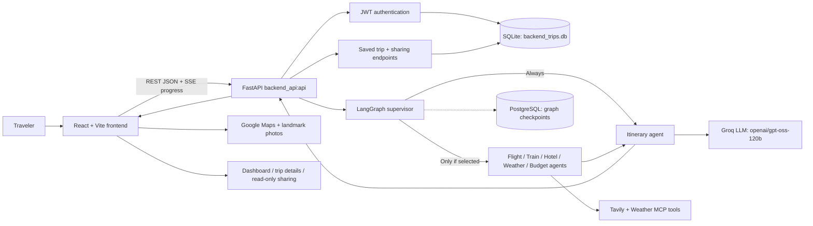
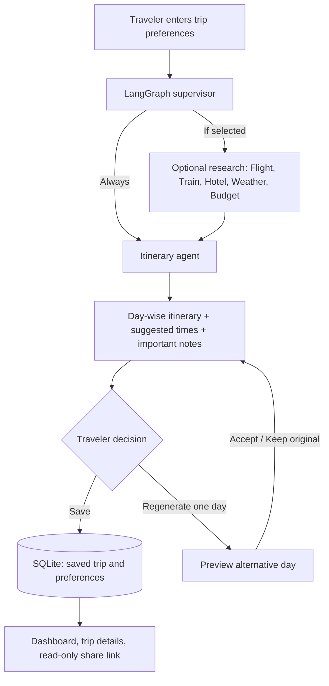

# Journey Gen AI — System Architecture Diagrams

This file contains Mermaid source code for editing the two diagrams. You can paste each block into a Mermaid-compatible Markdown editor or Mermaid Live Editor.

## 1. Overall system architecture

**Implementation note:** Bus and road transport options are handled within the itinerary flow; the checked `main.py` does not define separate `bus_agent` or `road_agent` LangGraph nodes.

## 2. Conditional agent workflow

### Key technologies

- **Frontend:** React, Vite, Axios, CSS, `lucide-react`.
- **Backend:** Python, FastAPI, Pydantic, JWT, SSE.
- **AI workflow:** LangGraph, Groq `openai/gpt-oss-120b`.
- **Research:** MCP integrations, Tavily search, weather and forecast tools; other configured services may be available.
- **Storage:** SQLite for users/saved trips; PostgreSQL checkpointing when configured.
- **Presentation:** Google Maps links, landmark photography when available, PDF/export, public read-only shared links.

**Caution:** Travel research, times and indicative budgets are planning information, not confirmed bookings or live quotes.
